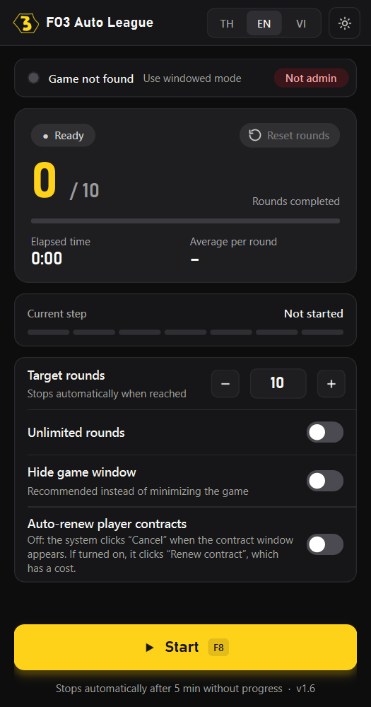

# FO3 Auto League

A Windows desktop tool that automates repetitive League (VS COM) matches in FIFA Online 3 (Thai version) using computer vision. It finds on-screen buttons by template matching and clicks them in the background without moving the mouse.

## Overview

I built this to see how far I could automate a real application that has no API, using only what is on screen. It is released as a free download and has real users, which pushed me to solve problems a personal script never meets: many screen sizes, failures in the field, safe packaging, and multiple languages.

> The source code is not public. A code walkthrough is available on request.

## Features

- **Background clicking:** sends clicks to the game window without taking over the mouse.
- **Works across screen sizes:** UI scaling is handled for 4:3, 5:4, 16:10 and 16:9 windows (tested from 1024x768 up to 1920x1071), including windows where the game clips the right edge of the UI.
- **Stuck detection:** saves a screenshot when the bot stalls, so problems can be diagnosed.
- **Optional auto contract renewal:** off by default because it costs in-game currency.
- **Three languages:** Thai, English and Vietnamese UI.
- **Single-file release:** distributed as one `.exe` with a published SHA-256 checksum.

## How it works

1. **Capture:** grabs frames from the game window.
2. **Match:** locates button images with OpenCV template matching.
3. **Act:** sends a click to the matched position through the Win32 API.
4. **Loop:** a state loop decides what to press next and recovers when the screen is not what it expects.

### Engineering notes

- **About 10x faster matching:** the search runs on a half-size grayscale image first, then verifies at full size only around the best candidates. Matching time dropped from about 1 s to about 0.1 s per frame at high resolution, with results identical to the exhaustive search (verified by tests).
- **Resolution handling:** the game scales its UI with window height, so button templates are scaled by `window height / 480`. For buttons that score near the threshold, higher-resolution templates captured from real frames raised match scores from about 0.82-0.86 to 0.88-0.95.
- **Safe, self-contained release:** assets are embedded at build time, and the build script verifies that the `.exe` ignores any files planted next to it.
- **Tested:** 265 pytest tests covering matching, scaling, window detection, packaging and i18n.

## Tech stack

| Area | Tools |
|---|---|
| Language | Python |
| Computer vision | OpenCV, NumPy |
| GUI | PySide6 (Qt) |
| Windows integration | pywin32, windows-capture |
| Packaging | Nuitka, PyInstaller |
| Testing | pytest |

## Download and usage

Get the latest `FO3AutoLeague-vX.X.zip` from [Releases](https://github.com/S-Krommarin/Fo3-AutoClick/releases/latest), extract it, and run `FO3AutoLeague.exe`.

1. Set the game to windowed mode.
2. Run the program and accept the UAC prompt (the game runs as Administrator).
3. Press **Start** or **F8**. Press F8 again to stop.

The SHA-256 checksum for each release is published in its `.sha256` file. The executable is not code-signed, so SmartScreen or antivirus software may show a warning.

## User guide

Full instructions, FAQ and troubleshooting in Thai, English and Vietnamese: [USER_GUIDE.md](USER_GUIDE.md).

## Disclaimer

Using automation tools may violate a game operator's terms of service; use at your own risk. This is an independent project and is not affiliated with the developer or operator of FIFA Online 3.
